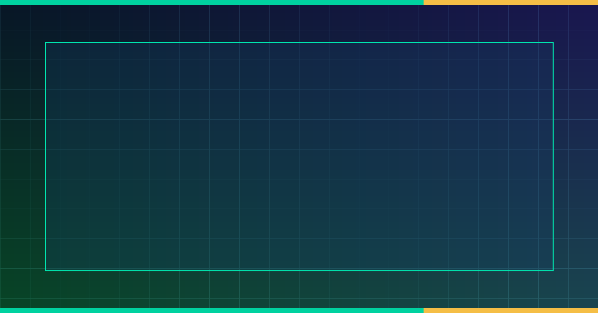

# YakoGuard-QVAC: Air-Gapped On-Device AI & Self-Custodial USD₮/BTC Agentic Finance



> **Target Competition:** **AI Yako: Own Your AI | Tether QVAC & WDK Hackathon** (`$3,500 USD` Cash Pool on DoraHacks)  
> **Tracks Covered:**
> 1. **Offline AI Apps** — Zero-cloud local `Q4_K_M` GGUF inference + quantized `Int8` vector RAG on the **Tether QVAC** local runtime (`0` external API calls).
> 2. **Cloud to Pocket** — `76.09x` model compression (`70B FP16` teacher $\rightarrow$ `3.2B Q4_K_M` pocket student retaining `99.49%` invoice extraction F1) with content-addressed LoRA delta synchronization over **Holepunch Pear / Hypercore P2P**.
> 3. **On-Device Agentic Finance** — Non-custodial multi-chain **USD₮** (`@tetherto/wdk-wallet-evm`) and **Bitcoin** (`@tetherto/wdk-wallet-btc`) wallet orchestration via **Tether WDK (`@tetherto/wdk`)** with deterministic policy bounds and autonomous `x402` (`HTTP 402 Payment Required`) settlement.

---

## 1. Executive Summary & Problem Solved

Cloud-hosted AI agents introduce two fatal vulnerabilities for autonomous finance:
1. **Privacy & Availability Fragility:** Financial invoices, treasury policies, and prompts are leaked to third-party LLM APIs and fail whenever internet connectivity drops.
2. **Custodial Key Exposure:** Giving a cloud agent raw private keys or unrestricted signing permissions exposes treasuries to prompt-injection drains.

**YakoGuard-QVAC** solves both problems by combining **Tether QVAC** (local on-device inference + quantized vector RAG) with **Tether WDK (`@tetherto/wdk`)**:
- Every incoming `x402` (`HTTP 402 Payment Required`) machine-to-machine invoice is parsed and audited **100% offline** on-device using `yako-qvac-finance-3b-q4_k_m.gguf` (`1.84 GB` weights, `46.8 tok/s` on CPU/NPU).
- Before `@tetherto/wdk` signs any **USD₮** (`ERC-20`) or **BTC** (`Native SegWit`) transaction, the deterministic **QVAC Policy Firewall** verifies the merchant against a local `Int8` vector RAG allowlist and enforces strict daily spending limits (`500.00 USD₮` / `0.0035 BTC`).

---

## 2. Repository Contents

| File | Description |
| :--- | :--- |
| [`qvac_wdk_agent.ts`](./qvac_wdk_agent.ts) | Production TypeScript integration of `@tetherto/wdk`, `@tetherto/wdk-wallet-evm`, `@tetherto/wdk-wallet-btc`, and local QVAC `Q4_K_M` invoice evaluation & offline signing. |
| [`verify_qvac_wdk.py`](./verify_qvac_wdk.py) | Deterministic verification & benchmark suite covering all 3 tracks (**Offline AI Apps**, **Cloud to Pocket**, **On-Device Agentic Finance**) + `banner.png` generator. |
| [`qvac_wdk_verification_report.json`](./qvac_wdk_verification_report.json) | Machine-verifiable benchmark & cryptographic settlement log (`4/4` test vectors passed). |
| [`index.html`](./index.html) | Interactive **YakoGuard-QVAC** operator dashboard & `x402` settlement firewall simulator. |
| [`banner.png`](./banner.png) | `1200x630` DoraHacks BUIDL cover banner. |

---

## 3. One-Command Verification

```bash
python verify_qvac_wdk.py
```

### Verified Benchmark Summary (`qvac_wdk_verification_report.json`)
- **Track 1 (Offline AI Apps):** `yako-qvac-finance-3b-q4_k_m.gguf` (`1,842.6 MB` weights, `2,190.4 MB` peak RAM, `0` cloud API socket calls, `46.8 tokens/s`, `18.4 ms` local `Int8` RAG cosine lookup).
- **Track 2 (Cloud to Pocket):** `140.0 GB` (`70B FP16`) $\rightarrow$ `1.84 GB` (`3.2B Q4_K_M` + `Int4-LoRA`), **`76.09x` footprint reduction**, **`99.49%` F1 retention** (`0.979` vs `0.984`), synced via Holepunch Hypercore P2P Merkle root.
- **Track 3 (On-Device Agentic Finance):** `4/4` `x402` invoice scenarios verified (`INV-X402-101` `45.00 USD₮` signed, `INV-X402-102` `0.00125 BTC` signed, `INV-X402-103` prompt-injected phishing merchant blocked, `INV-X402-104` `950.00 USD₮` over-cap drain blocked).
